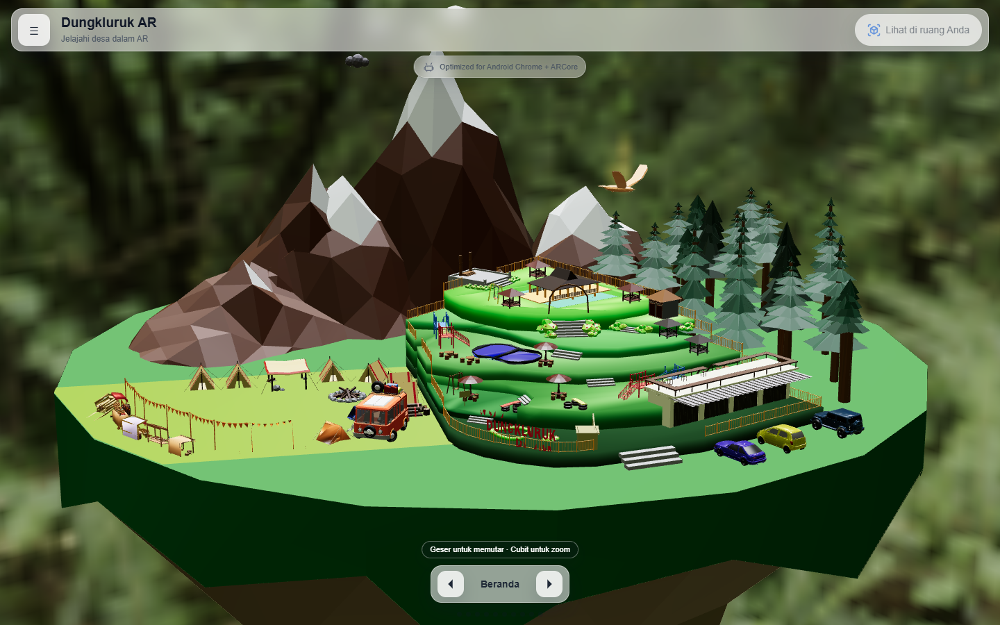
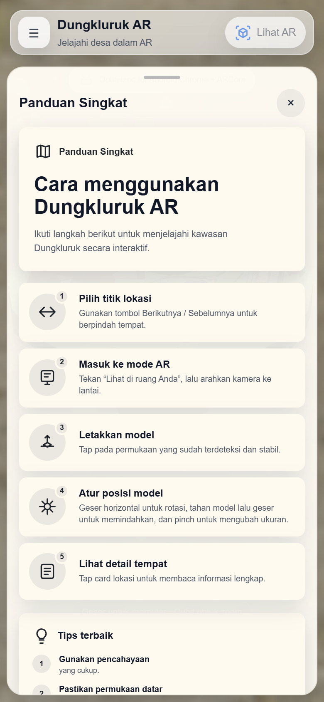
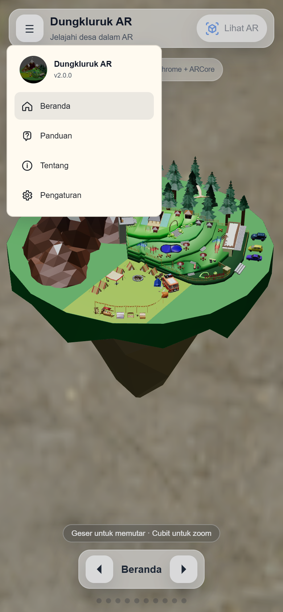
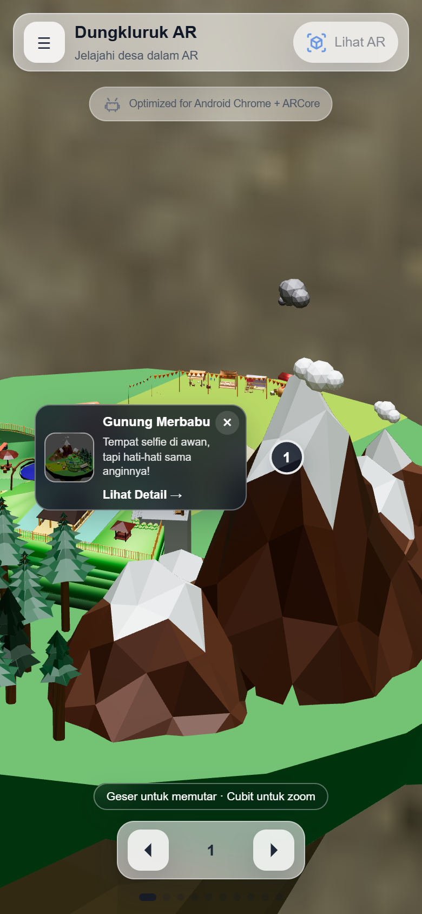
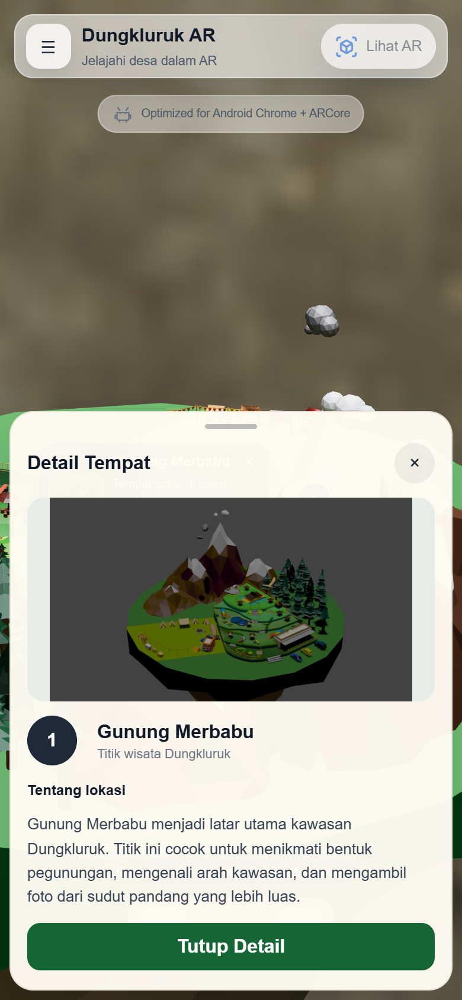
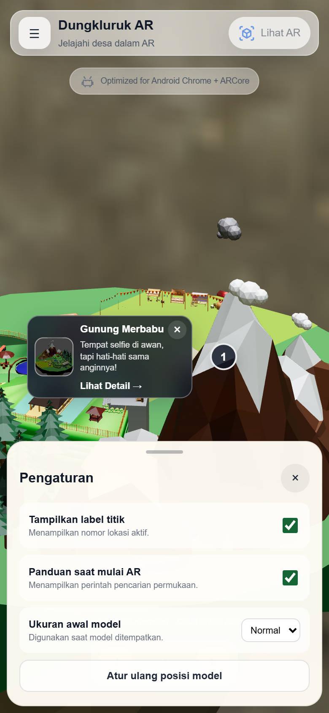
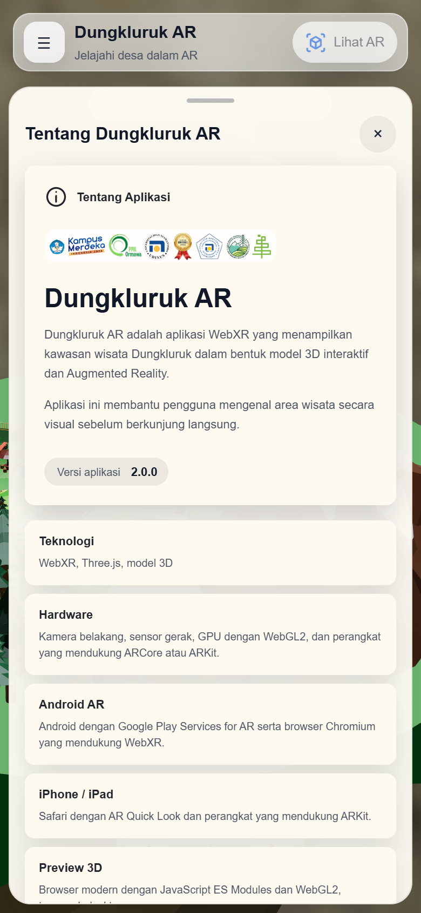
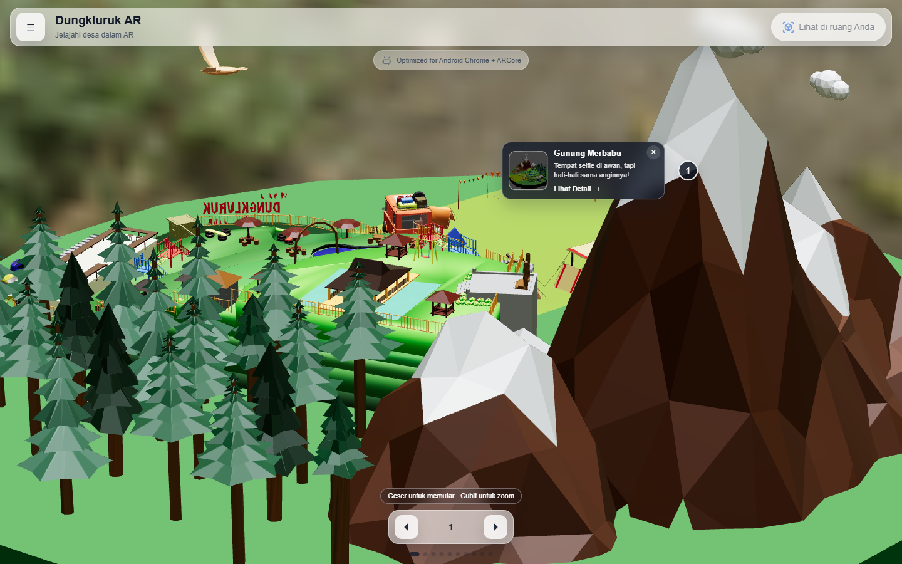
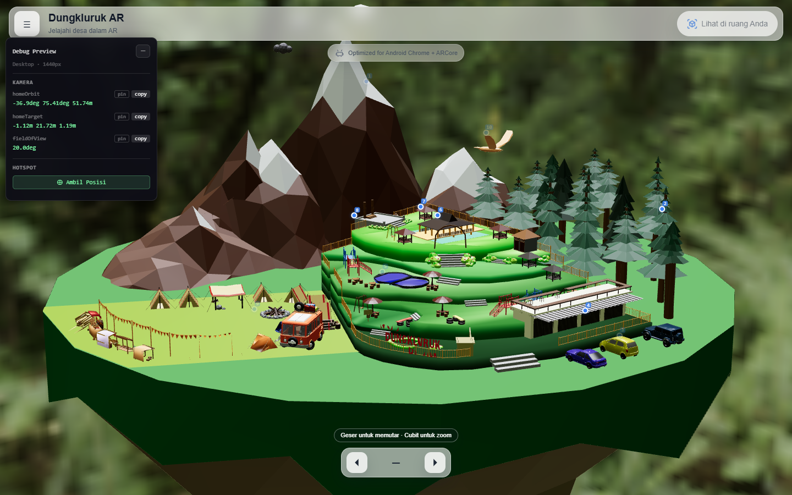

# Dungkluruk AR

Aplikasi web **WebXR** untuk menjelajahi kawasan wisata **Dungkluruk** melalui model 3D interaktif dan **Augmented Reality (AR)**. Pengguna dapat memutar model di browser, berpindah antar 10 titik wisata, membaca detail tiap lokasi, lalu menempatkan model kawasan di ruang nyata lewat kamera ponsel.



---

## Daftar Isi

1. [Fitur Utama](#fitur-utama)
2. [Tangkapan Layar](#tangkapan-layar)
3. [Dukungan Perangkat](#dukungan-perangkat)
4. [Panduan Pengguna](#panduan-pengguna)
5. [Instalasi & Menjalankan Proyek](#instalasi--menjalankan-proyek)
6. [Menguji AR di Ponsel](#menguji-ar-di-ponsel)
7. [Struktur Proyek](#struktur-proyek)
8. [Konfigurasi Model & Titik Wisata](#konfigurasi-model--titik-wisata)
9. [Mode Debug](#mode-debug)
10. [Build & Deploy ke GitHub Pages](#build--deploy-ke-github-pages)
11. [Dukungan Offline (PWA)](#dukungan-offline-pwa)
12. [Skrip npm](#skrip-npm)
13. [Pemecahan Masalah](#pemecahan-masalah)

---

## Fitur Utama

- **Pratinjau 3D interaktif** — putar, geser, dan zoom model kawasan Dungkluruk langsung di browser (desktop maupun ponsel), memakai [`@google/model-viewer`](https://modelviewer.dev/).
- **10 titik wisata (hotspot)** — Gunung Merbabu, Kalipasang, Parkir, Toko-Toko, Kolam Renang, Pendopo, Musholla, Gardu Pandang, Camping Ground, dan Burung. Kamera bergerak otomatis ke setiap titik.
- **Kartu & detail lokasi** — tiap titik punya kartu ringkas dan halaman detail berisi deskripsi lengkap.
- **Mode AR**
  - **Android**: WebXR (`immersive-ar`) dengan hit-test, deteksi permukaan, reticle pemindai, bayangan, dan estimasi cahaya, dibangun dengan [Three.js](https://threejs.org/).
  - **iPhone / iPad**: AR Quick Look (file `.usdz`) melalui Safari.
- **Gestur AR** — geser horizontal untuk rotasi, tahan + geser untuk memindahkan, pinch untuk mengubah ukuran.
- **Pengaturan tersimpan** — label titik, panduan AR, dan ukuran awal model disimpan di `localStorage`.
- **PWA & offline** — service worker menyimpan aset penting sehingga aplikasi tetap bisa dibuka saat koneksi terputus.
- **Tata letak responsif** — komposisi kamera terpisah untuk mobile dan desktop (breakpoint 800px).

---

## Tangkapan Layar

### Mobile

| Panduan (tampil saat pertama dibuka) | Menu samping | Titik wisata |
| :---: | :---: | :---: |
|  |  |  |

| Detail tempat | Pengaturan | Tentang |
| :---: | :---: | :---: |
|  |  |  |

### Desktop

| Beranda | Titik wisata |
| :---: | :---: |
|  |  |

> Tampilan mode AR tidak disertakan karena hanya bisa direkam dari kamera ponsel yang mendukung ARCore/ARKit.

---

## Dukungan Perangkat

| Platform | Mode | Persyaratan |
| --- | --- | --- |
| **Android** | WebXR AR (direkomendasikan) | Chrome / browser Chromium dengan WebXR, [Google Play Services for AR](https://developers.google.com/ar/devices) terpasang, perangkat ARCore |
| **iPhone / iPad** | AR Quick Look | Safari, perangkat yang mendukung ARKit |
| **Desktop / lainnya** | Pratinjau 3D saja | Browser modern dengan ES Modules dan WebGL2 |

Kebutuhan perangkat keras: kamera belakang, sensor gerak, dan GPU dengan WebGL2.
AR **wajib dibuka lewat HTTPS** (atau `localhost`) karena WebXR dan akses kamera tidak tersedia di koneksi HTTP biasa.

---

## Panduan Pengguna

### 1. Membuka aplikasi
Saat pertama dibuka, layar pemuat menampilkan logo lalu panel **Panduan Singkat** muncul otomatis. Tutup panel dengan tombol **×** untuk melihat model.

### 2. Menjelajahi pratinjau 3D
- **Geser** (satu jari / klik-tahan mouse) untuk memutar model.
- **Cubit** (pinch) atau scroll mouse untuk zoom.
- Tombol **◀ / ▶** di bawah layar berpindah ke titik wisata sebelumnya / berikutnya. Indikator titik di bawahnya menunjukkan posisi Anda (1–10). Label tengah bertuliskan **Beranda** saat kamera di posisi awal.

### 3. Melihat detail lokasi
Saat sebuah titik aktif, kartu lokasi muncul di samping penanda bernomor.
- Tekan **Lihat Detail →** untuk membuka halaman detail (gambar, nama, dan deskripsi lengkap).
- Tekan **×** di kartu untuk menyembunyikannya; tekan penanda bernomor untuk menampilkannya lagi.

### 4. Masuk ke mode AR
1. Tekan **Lihat di ruang Anda** (desktop) / **Lihat AR** (mobile) di pojok kanan atas.
2. Izinkan akses kamera.
3. Arahkan kamera ke lantai dan gerakkan ponsel perlahan sampai permukaan terdeteksi (reticle berubah siap).
4. **Tap** untuk meletakkan model.
5. Atur model:
   - **Geser horizontal** → rotasi
   - **Tahan model + geser** → pindahkan
   - **Pinch** → ubah ukuran
6. Tekan **Cari tempat lain** untuk meletakkan ulang model di permukaan lain.

Di iPhone/iPad, tombol yang sama membuka **AR Quick Look** bawaan iOS.

**Tips:** gunakan pencahayaan yang cukup, pilih permukaan datar bertekstur, dan jaga jarak aman dari benda di sekitar.

### 5. Menu samping (☰)
| Menu | Fungsi |
| --- | --- |
| **Beranda** | Ringkasan: tombol Mulai AR, Pratinjau 3D, jumlah titik, dan status model |
| **Panduan** | Langkah penggunaan dan tips |
| **Tentang** | Informasi aplikasi, versi, teknologi, dan tautan cek dukungan perangkat |
| **Pengaturan** | Opsi tampilan dan AR (lihat di bawah) |
| **Keluar** | Keluar dari sesi AR dan kembali ke pratinjau 3D |

### 6. Pengaturan
| Opsi | Keterangan |
| --- | --- |
| Tampilkan label titik | Menampilkan nomor lokasi aktif |
| Panduan saat mulai AR | Menampilkan instruksi pencarian permukaan saat masuk AR |
| Ukuran awal model | Kecil (0.8×), Normal (1×), Besar (1.25×) saat model ditempatkan |
| Atur ulang posisi model | Mengembalikan posisi model AR |

Semua pengaturan tersimpan otomatis di browser (`localStorage`, kunci `dungkluruk-ar-settings`).

---

## Instalasi & Menjalankan Proyek

### Prasyarat
- [Node.js](https://nodejs.org/) **18 atau lebih baru** (CI memakai Node 20)
- npm (ikut terpasang bersama Node.js)

### Langkah

```bash
# 1. Masuk ke folder proyek
cd Augmented-Reality-Dungkluruk

# 2. Pasang dependensi
npm install        # atau: npm ci

# 3. Jalankan server pengembangan
npm run dev
```

Buka alamat yang muncul di terminal, biasanya `http://localhost:5173/`.

Server dijalankan dengan `host: true`, sehingga juga dapat diakses dari perangkat lain di jaringan yang sama melalui alamat `Network` yang ditampilkan Vite (mis. `http://192.168.1.10:5173/`).

> Saat `npm run dev` / `npm run build`, plugin Vite otomatis menyalin decoder Draco dari `node_modules/three` ke `public/assets/draco/`.

---

## Menguji AR di Ponsel

WebXR hanya berjalan di **HTTPS**. Alamat IP lokal (`http://192.168.x.x`) tidak cukup untuk masuk mode AR. Beberapa pilihan:

1. **Tunnel HTTPS** (paling mudah) — misalnya `ngrok`, `cloudflared`, atau sejenisnya:
   ```bash
   npm run dev
   ngrok http 5173
   ```
   Karena Vite memblokir host yang tidak dikenal, daftarkan domain tunnel di file `.env.local`:
   ```env
   ALLOWED_HOSTS=abcd-1234.ngrok-free.app
   ```
   Beberapa host dipisahkan koma. Jalankan ulang `npm run dev` setelah mengubah file ini.

2. **Port forwarding Chrome (Android + USB)** — aktifkan USB debugging, buka `chrome://inspect/#devices` di komputer, tambahkan *Port forwarding* `5173 → localhost:5173`, lalu buka `http://localhost:5173` di Chrome ponsel.

3. **Deploy ke GitHub Pages** — lihat bagian [Build & Deploy](#build--deploy-ke-github-pages).

---

## Struktur Proyek

```
Augmented-Reality-Dungkluruk/
├── index.html              # Struktur halaman & seluruh elemen UI
├── app.ts                  # Titik masuk: inisialisasi preview, AR, hotspot, pengaturan, service worker
├── style.css               # Mengimpor seluruh file di styles/
├── modules/
│   ├── config.ts           #  Konfigurasi model, kamera, & 10 titik wisata
│   ├── types.ts            # Tipe TypeScript bersama
│   ├── dom.ts              # Referensi elemen DOM
│   ├── ui.ts               # Pembuatan kartu hotspot, state UI AR, petunjuk gestur
│   ├── settings.ts         # Pengaturan pengguna (localStorage)
│   ├── scene.ts            # Scene Three.js, loader GLB + Draco, environment HDR
│   ├── three.ts            # Ekspor Three.js yang dipakai
│   ├── math.ts             # Utilitas matematika
│   ├── debug.ts            # Panel debug (?debug)
│   ├── ar/
│   │   ├── controller.ts   # Alur sesi AR (scan → place → interaksi)
│   │   ├── session.ts      # Request sesi WebXR & deteksi Quick Look
│   │   ├── placement.ts    # Hit-test, reticle, grid permukaan
│   │   ├── gestures.ts     # Rotasi, geser, pinch
│   │   ├── anchors.ts      # WebXR anchors
│   │   ├── lighting.ts     # Estimasi cahaya
│   │   └── shadows.ts      # Bayangan model di lantai
│   ├── hotspots/
│   │   ├── controller.ts   # Navigasi antar titik
│   │   ├── preview.ts      # Hotspot di pratinjau 3D
│   │   └── ar.ts           # Hotspot di mode AR
│   └── preview/
│       ├── controller.ts   # Kontrol model-viewer
│       └── camera.ts       # Transisi kamera antar titik
├── styles/                 # CSS modular (tokens, panel, navigasi, AR, responsif, dll.)
├── public/
│   ├── manifest.json       # Manifest PWA
│   ├── sw.js               # Service worker (cache offline)
│   └── assets/
│       ├── dungkluruk_1.glb                 # Model 3D (web & Android)
│       ├── dungkluruk.usdz                  # Model 3D untuk iOS Quick Look
│       ├── dungkluruk.webp                  # Gambar pratinjau / kartu
│       ├── whipple_creek_regional_park_04_1k.hdr  # Environment lighting
│       ├── draco/                           # Decoder Draco (disalin otomatis)
│       └── *.svg, ar_icon.png               # Logo & ikon
├── docs/screenshots/       # Gambar untuk README ini
├── vite.config.js          # Konfigurasi Vite + plugin Draco & versi service worker
├── tsconfig.json
├── eslint.config.js
└── .github/workflows/deploy.yml  # CI/CD ke GitHub Pages
```

---

## Konfigurasi Model & Titik Wisata

Hampir semua penyesuaian konten dilakukan di **[`modules/config.ts`](modules/config.ts)**.

### Mengganti model 3D

```ts
model: {
  glbUrl: "./assets/dungkluruk_1.glb",     // model untuk web & Android
  usdzUrl: "./assets/dungkluruk.usdz",     // model untuk iOS Quick Look
  environmentUrl: "./assets/whipple_creek_regional_park_04_1k.hdr",
  dracoDecoderUrl: "./assets/draco/",
  alt: "Dungkluruk",
  scale: 0.025,                            // skala model di mode AR
  orientation: [0, 0, 0],
  interactionPlaneY: 0,
},
```

1. Letakkan file `.glb` (boleh terkompresi Draco) dan `.usdz` baru di `public/assets/`.
2. Ubah `glbUrl` dan `usdzUrl`.
3. Sesuaikan `scale` agar ukuran model di AR pas.
4. Atur ulang `preview.mobile` / `preview.desktop` (posisi kamera awal) dan koordinat hotspot — gunakan [Mode Debug](#mode-debug).

### Menambah / mengubah titik wisata

Setiap titik didefinisikan di array `hotspotDefinitions`:

```ts
{
  header: "Pendopo",                          // nama titik
  description: "Debat seru sambil ngopi...",  // teks kartu ringkas
  detail: "Pendopo merupakan area ...",       // teks halaman detail
  // imageUrl: "./assets/pendopo.webp",       // (opsional) gambar khusus titik ini
  anchor: {
    mobile:  { position: { x, y, z }, normal: { x, y, z } },
    desktop: { position: { x, y, z }, normal: { x, y, z } },
  },
  camera: {
    mobile:  { orbit: "...deg ...deg ...m", target: "...m ...m ...m", fieldOfView: "...deg" },
    desktop: { orbit: "...", target: "...", fieldOfView: "..." },
  },
}
```

Urutan tampil (dan nomor 1–10) ditentukan oleh array **`hotspotOrder`**. Nama di `hotspotOrder` harus sama persis dengan `header`; jika tidak, aplikasi melempar error `Konfigurasi hotspot "..." tidak ditemukan.`

`anchor` dan `camera` harus diisi lengkap untuk **mobile dan desktop**, karena masing-masing tampilan memakai komposisi kamera sendiri.

### Pengaturan pratinjau lainnya

| Properti | Keterangan |
| --- | --- |
| `preview.desktopBreakpoint` | Lebar layar (px) batas mobile/desktop, default `800` |
| `preview.mobile` / `preview.desktop` | Posisi kamera awal (`homeOrbit`, `homeTarget`, `fieldOfView`) |
| `preview.cameraTransitionMs` | Durasi animasi kamera antar titik (ms) |
| `preview.exposure`, `preview.shadowIntensity` | Pencahayaan pratinjau |
| `app.version` | Versi yang tampil di menu & halaman Tentang |

---

## Mode Debug

Tambahkan parameter URL untuk membantu pengembangan:

| URL | Fungsi |
| --- | --- |
| `?debug` | Menampilkan panel **Debug Preview** di pratinjau 3D |
| `?debugHotspots` | Menampilkan penanda titik wisata pada model saat mode AR |

Contoh: `http://localhost:5173/?debug`



Panel debug menampilkan nilai kamera saat ini (`homeOrbit`, `homeTarget`, `fieldOfView`) untuk mode mobile/desktop sesuai lebar jendela. Cara memakainya untuk membuat titik baru:

1. Putar & zoom model sampai komposisi kamera sesuai keinginan.
2. Tekan **copy** pada nilai kamera, lalu tempel ke bagian `camera` di `config.ts`.
3. Tekan **⊕ Ambil Posisi**, lalu klik permukaan model untuk mendapatkan `position` dan `normal` (anchor hotspot). Tekan **Esc** untuk batal.
4. Gunakan **coba** untuk mempratinjau hasil pick, dan **Hapus** / **Hapus Semua Pick** untuk membersihkan.
5. Ulangi dengan lebar jendela < 800px (atau DevTools mode perangkat) untuk mengisi nilai **mobile**.

---

## Build & Deploy ke GitHub Pages

### Build lokal

```bash
npm run build      # hasil di folder dist/
npm run preview    # menjalankan hasil build secara lokal
```

Saat build, plugin Vite mengganti `__APP_VERSION__` di `dist/sw.js` dengan ID build unik, sehingga cache service worker diperbarui setiap rilis.

### Deploy otomatis

Workflow [`.github/workflows/deploy.yml`](.github/workflows/deploy.yml) berjalan setiap **push ke branch `main`** (atau dijalankan manual lewat *workflow_dispatch*):

1. `npm ci`
2. `npm run typecheck`
3. `npm run lint`
4. `npm run build`
5. Upload `dist/` dan deploy ke GitHub Pages

Langkah awal di repositori GitHub:

1. Buka **Settings → Pages**.
2. Pada **Source**, pilih **GitHub Actions**.
3. Push ke `main`. Situs tersedia di `https://feby-akliji23.github.io/Augmented-Reality-Dungkluruk/`.

> **Catatan:** `vite.config.js` mengambil `base` otomatis dari nama repositori (`GITHUB_REPOSITORY`) saat build di GitHub Actions, jadi aset tetap termuat walaupun nama repositori diganti. Namun alamat GitHub Pages ikut berubah dan link lama tidak dialihkan otomatis.

---

## Dukungan Offline (PWA)

- Service worker (`public/sw.js`) hanya aktif di **build produksi**, tidak saat `npm run dev`.
- Aset inti (halaman, manifest, ikon, gambar, decoder Draco) disimpan di cache saat pertama dibuka.
- Saat koneksi terputus, muncul banner *"Anda sedang offline. Aset yang pernah dibuka tetap dapat digunakan."*
- Aplikasi dapat dipasang ke layar utama ponsel (*Add to Home Screen*) dan berjalan dalam mode `standalone`.
- Di iOS, file `.usdz` (~19 MB) dimuat di latar belakang hanya jika koneksi tidak lambat dan *Data Saver* tidak aktif.

---

## Skrip npm

| Perintah | Fungsi |
| --- | --- |
| `npm run dev` | Server pengembangan Vite (hot reload) |
| `npm run build` | Build produksi ke `dist/` |
| `npm run preview` | Menjalankan hasil build secara lokal |
| `npm run typecheck` | Pemeriksaan tipe TypeScript (`tsc --noEmit`) |
| `npm run lint` | ESLint |
| `npm run format` | Merapikan kode dengan Prettier |
| `npm run format:check` | Mengecek format tanpa mengubah file |

---

## Pemecahan Masalah

| Masalah | Penyebab & solusi |
| --- | --- |
| Tombol **Lihat AR** tidak aktif | Perangkat/browser tidak mendukung WebXR AR atau Quick Look. Pastikan memakai Chrome Android dengan Google Play Services for AR, atau Safari di iOS. |
| AR tidak bisa dimulai | Halaman tidak dibuka lewat HTTPS. Gunakan tunnel HTTPS atau GitHub Pages. |
| `Blocked request. This host is not allowed` | Host tunnel belum didaftarkan. Tambahkan ke `ALLOWED_HOSTS` di `.env.local`. |
| Permukaan tidak terdeteksi | Tambah pencahayaan, arahkan ke lantai bertekstur (bukan lantai polos/mengkilap), gerakkan ponsel perlahan. |
| Model tidak muncul / layar pemuat lama | Periksa Console browser. Pastikan file `.glb` ada di `public/assets/` dan folder `draco/` berisi decoder (jalankan `npm install` lalu `npm run dev` sekali). |
| Aset 404 setelah deploy | Nilai `base` di `vite.config.js` tidak sesuai nama repositori. |
| Perubahan tidak muncul setelah deploy | Cache service worker lama. Muat ulang paksa (Ctrl+Shift+R) atau hapus data situs. |
| Error `Konfigurasi hotspot "..." tidak ditemukan` | Nama di `hotspotOrder` tidak sama dengan `header` di `hotspotDefinitions`. |

---

## Teknologi

- [Vite 6](https://vitejs.dev/) + [TypeScript 5](https://www.typescriptlang.org/)
- [Three.js 0.163](https://threejs.org/) — rendering & WebXR AR
- [@google/model-viewer 3.5](https://modelviewer.dev/) — pratinjau 3D & AR Quick Look
- WebXR Device API (`hit-test`, `dom-overlay`, `anchors`, `light-estimation`)
- ESLint + Prettier

---

**Dungkluruk AR v2.0.0** · Dibuat oleh Tim Dungkluruk AR
